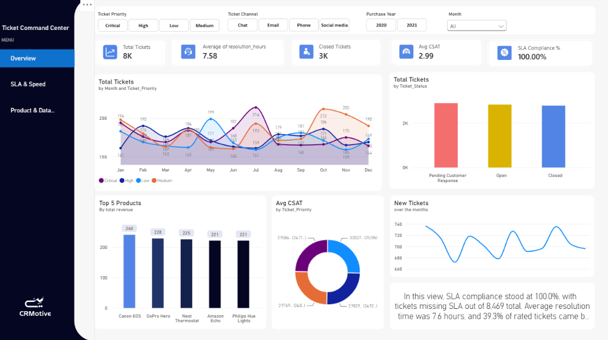

# Ticket Command Center: Customer Support Performance Analysis

Exploratory analysis in **Python** (pandas, seaborn) and a 3-page **Power BI** dashboard on 8,469 customer support tickets.

## Question
What explains whether a ticket gets closed and whether the customer is satisfied, and can the timestamps be trusted?

## Key findings
- **67.3%** of tickets are not closed: 2,881 pending a customer response and 2,819 open. Only 2,769 (32.7%) are closed.
- Average satisfaction is **2.99 out of 5**. **39.3%** of closed tickets are rated 4 or 5.
- Outcomes are flat across segments: the closed rate stays between 30% and 34% for every priority, channel, ticket type and gender.
- **49.3%** of closed tickets (1,365 of 2,769) have a resolution dated before the first response, so only 1,404 have a usable resolution time (average 7.6 hours).
- SLA compliance reads 100%: the longest valid resolution is 23.5 hours, under the 24-hour target.

## Tools
Python (pandas, NumPy, seaborn, matplotlib), Power BI (DAX measures, slicers, 3 report pages).

## Repository structure
| Folder | Contents |
|---|---|
| `notebook/` | `ticket_eda.ipynb`: cleaning, features, outliers, plots, export |
| `data/` | `ticket_clean.csv`: cleaned data used by Power BI (no names or emails) |
| `powerbi/` | `Ticket_Analysis_Mohamed_Nashat.pbix`: the dashboard |
| `report/` | `Ticket_Analysis_Report.pdf`: 4-page findings report |
| `images/` | Dashboard screenshots |

## Data
Public Kaggle dataset: [Customer Support Tickets Dataset](https://www.kaggle.com/datasets/suraj520/customer-support-ticket-dataset). The raw file is not included here. The data appears synthetic (example.com emails, random-word resolutions, near-identical rates in every category), so the results demonstrate method rather than real customer behavior.

## How to reproduce
1. Download the CSV from Kaggle and save it as `archive/customer_support_tickets.csv`.
2. Run `notebook/ticket_eda.ipynb`. The last cell writes `ticket_clean.csv`.
3. Open the `.pbix` file in Power BI Desktop and point the data source to `ticket_clean.csv` (Home, Transform data, Data source settings).

## Cleaning decisions
| Issue | Action |
|---|---|
| Resolution, resolution time and rating empty for 5,700 unclosed tickets | Left empty: they are missing only for unclosed tickets, so filling them would invent results. Not used to explain the Closed outcome (leakage). |
| 1,365 closed tickets resolved before the first response | Kept, flagged (`invalid_duration`), excluded from resolution-time and SLA figures |
| No ticket-created timestamp | First-response SLA not measurable; monthly charts use the purchase date |
| Template tag `{product_purchased}` left in descriptions | Replaced with the real product |
| Names and emails | Not exported |

## Limitations
- Synthetic-looking data with almost no differences between segments.
- SLA compliance is always 100% because no valid ticket exceeds 24 hours.
- No agent, team or ticket-created time, so workload and first-response speed cannot be measured.
- Satisfaction exists only for closed tickets.

## Author
Mohamed Nashat. Built as a capstone for a data analytics diploma.
